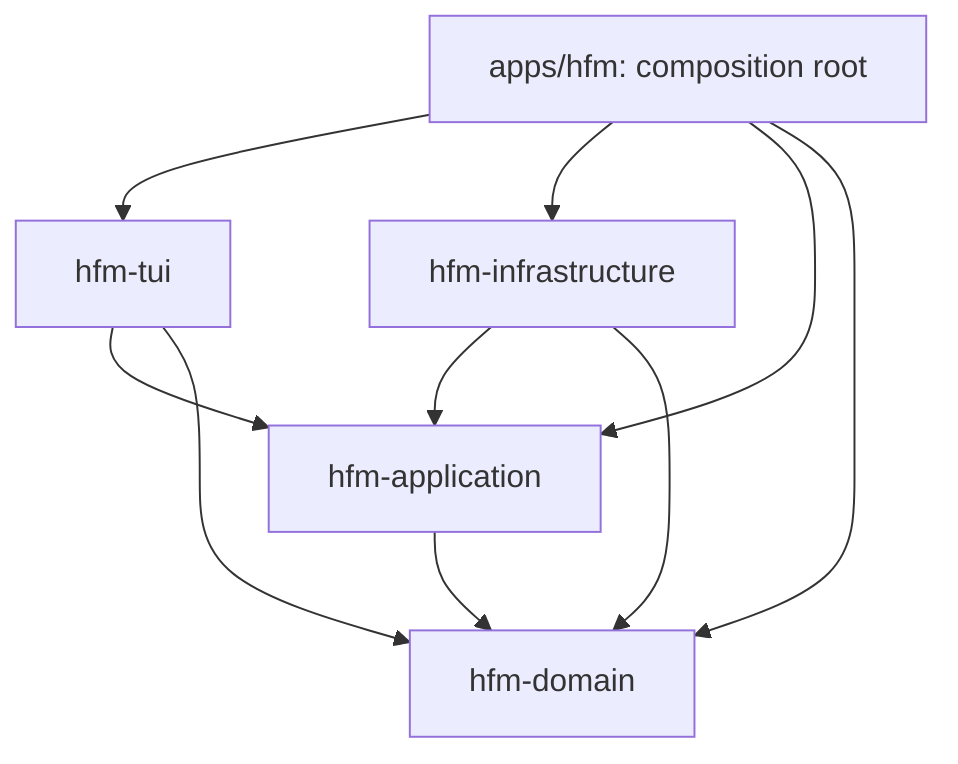
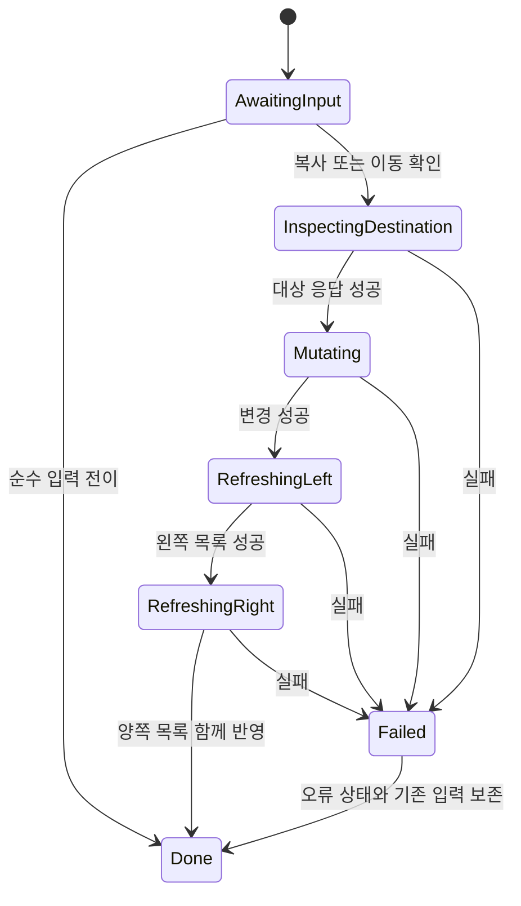

# 워크스페이스 아키텍처

`hfm`은 domain, application, infrastructure, tui, dev-tools와 실행 앱을 포함하는 Haskell 모노레포입니다. 루트 `stack.yaml`과 `cabal.project`가 같은 패키지를 등록합니다. 각 패키지의 `package.yaml`이 원본이고 Stack이 생성된 `.cabal`을 갱신합니다.

## 패키지 책임과 의존성

| 패키지 | 책임 | 로컬 의존성 |
|---|---|---|
| `packages/hfm-domain` | 엔트리·정렬·숨김·검색·경로 정책, 선택·텍스트 편집, 입력·설정·언어·테마 타입 | 없음 |
| `packages/hfm-application` | 순수 상태 머신·요청·오류, 파일·프로세스 포트와 다형적 실행기 | domain |
| `packages/hfm-infrastructure` | OS 파일 작업, 프로세스 실행, 예외 변환, 미리보기, YAML/XDG 설정, 재귀 검색 | domain, application |
| `packages/hfm-tui` | Brick 렌더링, Vty 입력·터미널, 번역·레이아웃·테마·구문 강조 | domain, application |
| `packages/hfm-dev-tools` | 워크스페이스 경계 검사 및 PTY 검증 | 없음 |
| `apps/hfm` | CLI 인자, 설정·IO 구현 주입, 터미널 실행 | domain, application, infrastructure, tui |



화살표는 컴파일 의존성입니다. infrastructure와 tui는 서로 의존하지 않습니다. domain과 application에는 구체적 IO, Brick/Vty, YAML, POSIX나 실제 파일 시스템 접근이 없습니다. 요청과 포트 계약은 application이 소유합니다. 공유 코드는 패키지 모듈 이름으로 import합니다.

## 도메인과 DCI

파일 관리 도메인의 공통 어휘는 `Entry`·`EntryKind`, `Selection`, 경로 정책, `Settings`로 표현합니다. 이 타입과 정책은 `hfm-domain`에 두고, 패널과 사용자 세션의 상태는 `hfm-application`에서 관리합니다. 파일 시스템을 읽어야 알 수 있는 사실은 바깥 어댑터가 확인하여 요청의 응답으로 전달합니다.

| DCI 관점 | 복사·이동에서의 구현 |
|---|---|
| Data | 양쪽 `Panel`의 경로·선택과 파일 `Entry` |
| Context | `TransferContext`가 복사·이동 구분, 선택된 `SourceEntry`, 입력으로 해석된 `RequestedDestination`을 묶습니다. 원본과 요청 목적지는 별도 타입이며 활성 패널이 어느 쪽이든 같은 방식으로 역할을 배정합니다. |
| Interaction | `Files`가 목적지 조회를 요청하고, 응답으로 최종 경로를 계산한 뒤 변경을 요청합니다. 변경 성공 후 `PanelRefresh`에 두 패널 갱신을 위임합니다. |

예를 들어 왼쪽에서 `notes.txt`를 선택하고 오른쪽 디렉터리로 복사하면, 현재 선택이 `SourceEntry`, 오른쪽의 경로가 `RequestedDestination` 역할을 맡습니다. 목적지가 디렉터리라는 응답이 돌아오면 순수 경로 정책이 그 경로에 `notes.txt`를 붙입니다. 대기 단계가 역할을 보유하므로 응답을 처리할 때 다시 선택을 읽지 않습니다.

## ADT 상태 머신

기존 화면 상태 `Mode`는 탐색, 검색, 작업 입력, 편집기 설정 입력, 삭제 확인, 파일 보기를 구분합니다. 테마 미리보기는 별도 `Maybe (Selection Theme)`로 보존하여 어느 화면에서도 열고 취소할 수 있습니다. `KeySequence = DirectInput | ControlXPrefix`는 접두 명령 상태, `Lifecycle = Continue | Quit`는 이벤트 처리 후 앱 실행 여부입니다.

작업의 진행 상태는 다음 타입으로 표현합니다.

```haskell
data Program result where
  Done :: result -> Program result
  Await :: Request response -> Phase response result -> Program result

data Phase response result where
  ReturningResponse :: Phase response (Either FileError response)
  Starting :: StartupStep response -> Phase response (Either FileError AppState)
  Working :: AppState -> TaskStep response -> Phase response (AppState, Lifecycle)

resume :: Phase response result -> Either FileError response -> Program result
```

`Program`에는 함수나 실행 가능한 액션을 저장하지 않습니다. `Await`는 타입이 일치하는 요청과 후속 단계 ADT를 저장합니다. `Request`와 `Phase`의 응답 타입이 연결되어 디렉터리 여부에 목록을 전달하거나 미리보기 결과에 종료 코드를 전달할 수 없습니다. `Machine.resume`이 성공·실패 응답을 받아 다음 요청 또는 완료 값을 만드는 순수 전이 함수입니다.

`StartupStep`과 `TaskStep`에는 해당 단계에 필요한 데이터가 들어 있습니다. `TaskStep`은 탐색·파일 변경·패널 갱신의 응답 타입을 각각 `NavigationStep`, `FileStep`, `RefreshStep`으로 연결하고 프로세스·설정의 단일 응답 단계도 표현합니다. 예를 들어 두 번째 패널 갱신 단계는 첫 번째 목록을 보유하고, 설정 저장 단계는 복구할 이전 상태를 보유합니다. 상태 전이는 `StateT`, `ExceptT`, 후속 함수에 숨겨지지 않습니다. ADT는 메모리에서 검사 가능한 값이며 직렬화 형식은 정의하지 않습니다.

| 작업 | 진행 단계 및 완료 조건 |
|---|---|
| 시작 | 왼쪽 경로 정규화 → 오른쪽 경로 정규화 → 왼쪽 목록 → 오른쪽 목록 → 초기 상태 |
| 탐색 | 경로 정규화 → 목록 읽기 → 활성 패널 경로·검색·선택 반영 |
| 심볼릭 링크 열기 | 디렉터리 여부 → 탐색 또는 미리보기 |
| 미리보기 | 바이트 읽기 → 바이너리 거부 또는 UTF-8 텍스트 보기 |
| 복사·이동 | 대상 디렉터리 여부 → 순수 대상 경로 계산 → 변경 → 두 패널 갱신 |
| 숨김 표시 전환 | 후보 표시 옵션으로 양쪽 목록 읽기 → 옵션과 목록 함께 반영 |
| 이름 변경·폴더 생성·삭제 | 입력 검증 또는 삭제 확인 → 변경 → 두 패널 갱신 |
| 편집기·셸 실행 | 대상·입력 검증 → 프로세스 요청 → 종료 코드 상태 → 두 패널 갱신 |
| 설정 변경 | 후보 설정 → 저장 요청 → 확정 또는 이전 설정·입력 복구 |
| 검색·입력 편집·선택·페이지·뷰어 스크롤 | 순수 화면 상태 전이 후 `Done` |
| 테마 미리보기 | 선택 이동·취소는 순수 전이, 변경한 테마 확정만 저장 요청 |
| 접두 명령·종료 | `KeySequence` 전이 → `Lifecycle` 완료 값 |



파일 변경 실패 시 작업 입력과 패널을 유지하고 후속 갱신을 요청하지 않습니다. 두 패널 갱신은 두 읽기가 모두 성공해야 반영합니다. 숨김 표시 전환 중 어느 한쪽이라도 읽기에 실패하면 이전 표시 옵션과 두 목록을 유지합니다. 이미 성공한 파일 변경은 갱신 실패로 취소되지 않으며 재실행하지 않습니다. 갱신 실패 상태는 파일 변경 완료 후의 탐색 모드와 이전 목록을 유지합니다.

## 순수 전이와 효과 실행의 경계

```text
Vty event
  → Tui.Input.fromVty
  → Workflow.planInput
  → Done 또는 Await Request Phase
  → Effects.Runtime: 주입된 포트로 요청 실행
  → Machine.resume: 응답으로 다음 상태 계산
  → 다음 Await 반복 또는 Done
  → 새 AppState 및 Lifecycle을 Brick에 반영
```

```haskell
planInput :: Input -> AppState -> Program (AppState, Lifecycle)
planStartup :: FilePath -> FilePath -> AppConfig -> (Int, Int)
            -> Program (Either FileError AppState)
runProgram :: Monad m => FileSystem m -> Processes m
           -> (Settings -> m (Either FileError ())) -> Program a -> m a
handleInput :: Monad m => FileSystem m -> Processes m
            -> (Settings -> m (Either FileError ()))
            -> Input -> AppState -> m (AppState, Lifecycle)
```

`Runtime`은 요청을 파일 포트, 프로세스 포트 또는 설정 저장 함수에 전달하고 결과를 `resume`에 돌려줍니다. 키나 설정 전후 상태를 비교하여 작업을 추론하지 않습니다. `handleInput`은 계획 생성과 실행을 연결합니다. `ReturningResponse`와 `request`는 단일 포트 요청의 결과를 그대로 반환할 때 사용합니다.

`F2`, 변경된 테마 확정, 유효한 편집기 입력 확정은 `SaveSettings` 요청을 생성합니다. 저장 성공 응답 뒤에만 후보 상태를 반환합니다. 저장 실패 시 이전 설정, 모드, 커서, 테마 메뉴를 복구하고 `SettingsSaveFailed`를 반환합니다. 편집기는 기본값과 같아도 명시적인 확정 시 저장하며, 현재 테마를 다시 선택하면 저장 없이 메뉴만 닫습니다. 미리보기 테마는 언어 저장에 포함되지 않습니다.

`EditFile`과 `RunCommand`는 종료 코드 `Int`를 받습니다. `Infrastructure.Process`는 편집기 실행 파일을 `proc`로 호출하여 파일 경로를 한 인자로 전달하고, 셸 명령은 Windows PowerShell 또는 Unix `/bin/sh`로 실행합니다. 프로세스의 cwd는 활성 패널 경로이며 앱 전역 작업 디렉터리는 바꾸지 않습니다. TUI는 파일 포트를 `liftIO`, 프로세스 포트를 `suspendAndResume'`로 감쌉니다. 명령 출력 확인 후 터미널을 복원합니다.

## application 모듈 책임

| 모듈 | 책임 |
|---|---|
| `State` | 화면·키 시퀀스 상태, 패널·선택 갱신, 뷰어 범위 |
| `Status`, `Error` | 표시 언어·OS와 무관한 결과와 오류 |
| `Program` | 효과 요청, 진행 단계, 응답 타입을 연결하는 ADT와 전송 역할 타입 |
| `Machine` | 응답을 해당 유스케이스의 순수 전이에 전달하고 공통 작업 실패 처리 |
| `Startup` | 초기 디렉터리 및 목록을 읽는 시작 단계 생성과 전이 |
| `Workflow` | 전역 키·접두 명령·모드에 맞는 상호작용 선택 |
| `Internal.Files` | 파일 작업 프롬프트, 참여 역할 배정, 파일 변경 단계 생성과 전이 |
| `Internal.Navigation` | 디렉터리 탐색·링크 판별·미리보기 단계 생성과 전이 |
| `Internal.PanelRefresh` | 두 패널 목록 읽기 및 목록과 숨김 표시 옵션을 함께 반영 |
| `Internal.Process` | 편집 대상·명령 검증, 프로세스 요청과 완료 처리 |
| `Internal.Settings` | 테마 선택, 편집기 설정 확정, 저장 성공·실패 전이 |
| `Internal.Interaction` | 검색·입력 편집, 선택 이동, 취소·삭제 확인·보기 제어 |
| `Effects.Ports` | `FileSystem m`, `Processes m` 계약 |
| `Effects.Runtime` | 요청 실행과 입력 진입점 연결 |

`Internal.*`은 Cabal의 `other-modules`로 외부에 노출하지 않습니다. 순수 application 모듈은 `Effects.*`, `FileSystem`, `Processes`를 참조하지 않습니다. production application은 `mtl`과 `transformers`에 의존하지 않습니다. 메모리 포트 테스트만 `mtl`의 `State`를 사용합니다.

## 파일 시스템과 표시 어댑터

`Domain.PathPolicy`는 상대·절대 경로 입력 해석, 생성·이름 변경의 단일 이름 검증, 대상이 디렉터리일 때 원본 이름을 붙이는 규칙과 경로 포함 관계를 계산합니다. 실제 존재 여부, 심볼릭 링크와 canonical path는 infrastructure가 확인합니다. 덮어쓰기 방지와 자기 내부 복사·이동 방지, 재귀 작업은 OS 어댑터 책임입니다. 검사와 변경 사이의 동시 파일 시스템 변경에 대한 원자적 트랜잭션을 제공하지는 않습니다.

`Infrastructure.Ports`는 `IOException`을 `FileError`로 변환합니다. 내부 계층은 OS 예외에 의존하지 않습니다. `Main`은 설정을 읽어 `AppConfig`를 구성하고 IO 구현을 주입합니다. 설정 어댑터는 임시 파일을 완성한 뒤 교체하며 읽기·파싱 오류를 숨기지 않습니다.

`Status`와 `FileError`의 표시 문구는 `Tui.I18n`이 번역합니다. 경로와 OS 오류 상세는 보존합니다. Brick 리스트는 domain의 `Selection`에서 렌더링할 때 생성합니다. 내부 상태에는 Brick 위젯을 보관하지 않습니다. `Tui.Layout`이 문자 셀 너비와 안내 행 수를 측정하고 application은 숫자 크기만 사용합니다.

## 검증과 확장

```bash
stack test --fast --ghc-options='-Werror -Wincomplete-patterns'
stack run hfm-check-architecture
stack exec hfm-test-keybindings -- "$(stack path --local-install-root)/bin/hfm"
```

아키텍처 검사는 워크스페이스 등록 일치, 패키지·모듈 의존 방향, 내부 계층의 외부 의존 및 구체적 IO 사용, 순수 모듈의 실행 포트 접근을 검사합니다. 정적 검사이므로 컴파일·동작 테스트와 함께 사용합니다.

- domain 테스트는 편집·선택·검색·경로 정책을 검증합니다.
- application의 `MachineSpec`은 IO 없이 시작 단계별 실패, 저장 확정·복원, 탐색·심볼릭 링크·미리보기, 변경 후 갱신 실패, 접두 명령 전이를 검증합니다.
- application의 메모리 포트 테스트는 파일·프로세스·설정 요청의 순서, 오류 전파, 입력·모드·테마 동작을 검증합니다.
- infrastructure 테스트는 임시 디렉터리의 실제 파일 작업과 설정 직렬화를 검증합니다.
- tui 테스트는 번역·레이아웃·테마·구문 강조를, PTY 검증은 실제 실행 파일의 키·파일 변경·프로세스 실행·설정 복원을 검증합니다.

새 작업은 `Request`와 응답 타입에 맞춘 진행 단계를 정의하고, 해당 유스케이스 모듈에 순수 전이를 추가합니다. 새 유스케이스를 추가하면 `Machine.resume`에서 응답을 해당 전이로 전달합니다. 일반 실패는 기존 상태를 유지하는 공통 전이를 사용합니다. 별도 복원이 필요하면 명시적인 실패 전이를 정의합니다. 실제 구현은 외부 어댑터에 두고 `Runtime`에서 포트에 연결합니다. 새 키는 순수 입력 처리에서 이 단계를 생성합니다.

`planInput`, `planStartup`, `resume`, `runProgram`의 호출 방식은 유지됩니다. 진행 단계 생성자를 직접 패턴 매칭하는 코드는 `Navigating`, `ChangingFiles`, `Refreshing` 아래에서 해당 단계를 매칭합니다.
