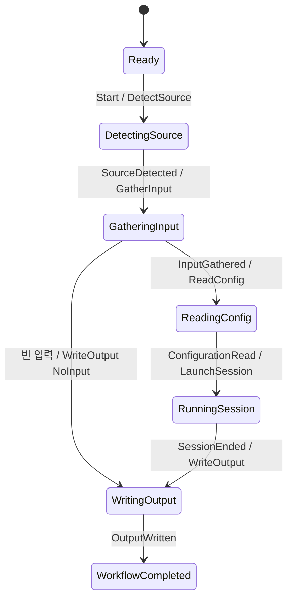

# fzh 아키텍처

## Workspace와 의존성

| 위치 | 패키지 | 책임 | 내부 의존성 |
|---|---|---|---|
| `packages/domain` | `fzh-domain` | 순수 도메인 모델과 상태 전이 | 없음, base만 사용 |
| `packages/application` | `fzh-application` | 실행 절차와 효과 포트 | fzh-domain |
| `packages/terminal` | `fzh-terminal` | Brick/Vty, YAML, 파일 시스템, 표준 입출력 | fzh-domain, fzh-application |
| `apps/fzh` | 루트 `fzh` 실행 파일 | 포트 조립과 실패 종료 | fzh-application, fzh-terminal |

공유 모듈은 명시적인 Cabal 패키지 의존성을 통해 import한다. 도메인과 애플리케이션에는
Brick, Vty, Text, Vector, IOException, YAML 타입이 들어가지 않는다. domain의 라이브러리는
base만 의존하며, 테스트의 Hspec 의존성은 라이브러리 의존성과 분리한다.

## 실행 절차 상태 머신

`Fzh.Application.Workflow`는 `(이벤트, 상태) → (다음 상태, 명령 목록)`을 계산한다.

활성 단계의 `OperationFailed`는 `WorkflowFailed`로 이동한다. 종료 상태는 흡수 상태이며
추가 명령을 만들지 않는다. 잘못된 단계의 이벤트도 무시한다. 설정 결과는 `ConfigLoaded`,
`ConfigMissing`, `ConfigInvalid`로 구별한다. 없는 설정과 잘못된 설정에는 기본값을 사용하며,
잘못된 설정은 `ReportWarning` 명령으로 보고한다.

`Fzh.Application.Ports.WorkflowPorts m`는 입력 소스 감지, 입력 수집, 설정 읽기, 세션 실행,
출력, 경고 보고를 추상화한다. `runWorkflow`는 추상 포트만 사용하여 명령을 실행한다.
`Runtime.workflowPorts`가 IO 구현을 제공하며, `Main`이 이를 조립한다.

## 검색과 세션 상태 머신

`Fzh.Domain.Search.Search`는 생성자를 숨겨 선택 인덱스의 유효성을 유지한다. 검색은
대소문자를 구분하지 않는 부분 순서 매칭을 사용한다. 점수, 경로 깊이 순서로 안정 정렬하며,
검색어 변경 시 첫 결과를 선택한다. 선택은 순수 리스트 지퍼로 유지하여 양방향 이동과
선택 조회를 O(1)에 수행하며 결과 범위를 벗어나지 않는다. Unicode 전체 소문자 변환의
U+0130 확장도 보존한다.

`Fzh.Domain.Session.Session`은 `Browsing Browser`와 `Finished ExitReason Browser`다.
`SessionEvent`가 검색어 편집, 목록 이동, 터미널 크기 변경, 확인/취소, 미리보기 완료를 표현한다.
`transitionSession`은 순수 함수이며 `ReadPreview` 또는 `StopSession` 명령을 반환한다.
확인과 취소는 `Confirmed`와 `Dismissed`로 구분한다. 두 종료 방식 모두 현재 선택을 출력하는
기존 동작을 유지한다.

| 미리보기 상태 | 의미 |
|---|---|
| `NoPreview` | 검색 결과 또는 선택 없음 |
| `Loading PreviewRequest` | 특정 요청의 파일 읽기 대기 |
| `Loaded FilePath String` | 읽기 성공 |
| `Failed FilePath PreviewError` | 파일 없음, 권한 없음, 기타 읽기 실패 |

요청은 증가하는 Integer 식별자와 경로를 포함한다. 응답이 현재 Loading 요청과 일치할 때만
내용을 적용한다. 같은 경로로 돌아와도 이전 요청의 응답은 무시한다. 선택이 같으면 읽기를
중복 요청하지 않는다. 빈 검색 결과는 이전 미리보기를 지운다. Finished는 모든 후속 이벤트를
무시한다.

`Event.toSessionEvent`가 Vty 입력을 도메인 이벤트로 변환하고, Event의 인터프리터는 명령을
실행한 후 결과 이벤트를 전달한다. 파일 읽기 실패를 내용 문자열로 위장하지 않는다.
`Types.AppState`는 도메인 세션, UI 설정, 화면용 Brick List 캐시를 보유한다.
`transitionApp`이 도메인 전이와 캐시 갱신을 함께 처리한다. 검색어가 바뀔 때만 결과를 Text/Vector로
다시 변환하고, 이동과 크기 변경에서는 기존 벡터를 재사용한다. 검색 상태의 원본은 도메인에만 있다. `UI`는 ADT 각 경우를 렌더링하고,
`SyntaxHighlight`는 읽기에 성공한 String 내용에서 최대 100줄을 먼저 제한한 뒤
Text로 변환하여 강조한다. 다시 그릴 때 전체 파일을 변환하지 않는다.

## 디렉토리 탐색 상태 머신

`Fzh.Domain.Discovery`의 상태는 경로 검사, 디렉토리 목록 대기, 탐색 완료다. 명령은
`InspectPath`, `ReadDirectory`이며, 응답 이벤트에는 경로와 성공/실패를 포함한다.
숨김/빌드 경로 제외 정책과 탐색 순서는 도메인에 있다. 어댑터가 디렉토리 항목의 전체 경로와
이름을 제공하므로 도메인은 filepath 라이브러리에 의존하지 않는다.

`FileSearch.listFilesWithIssues`는 상태 머신을 실행하여 파일과 `DiscoveryIssue` 목록을
반환한다. 한 경로가 실패해도 나머지를 탐색한다. `listFilesRecursive`는 문제를 stderr에
보고한다. 디렉토리 심볼릭 링크는 순환 방지를 위해 건너뛰고 파일 링크는 유지한다.
예외 변환은 IOException에 한정하여 비동기 취소 예외를 삼키지 않는다.

## 효과와 자원 경계

표준 입력은 Text의 엄격한 읽기를 사용하여 입력 오류가 포트 경계 안에서 발생하도록 한다.
설정은 ByteString 읽기와 YAML 해석을 나누어 파일 없음과 형식 오류를 구분한다.
터미널 생성과 종료는 `Runtime.runTerminal`에서 bracket으로 관리한다. `/dev/tty`를 사용하여
파이프 입력에서도 키 입력을 받는다. 프레임워크 타입은 터미널 패키지에 한정한다.

## 검증

`stack test --fast --test-arguments='+RTS -N2 -RTS'`는 도메인, 애플리케이션, 터미널 테스트를
실행한다. 기존 검색/레이아웃/오류 메시지/구문 강조 테스트와 순수 전이 테스트, 포트 대역을
사용하는 실행 순서 테스트, 실제 임시 파일을 사용하는 어댑터 테스트를 포함한다.
`stack build --pedantic --fast --test --no-run-tests`로 전체 컴포넌트의 경고도 검사한다.
