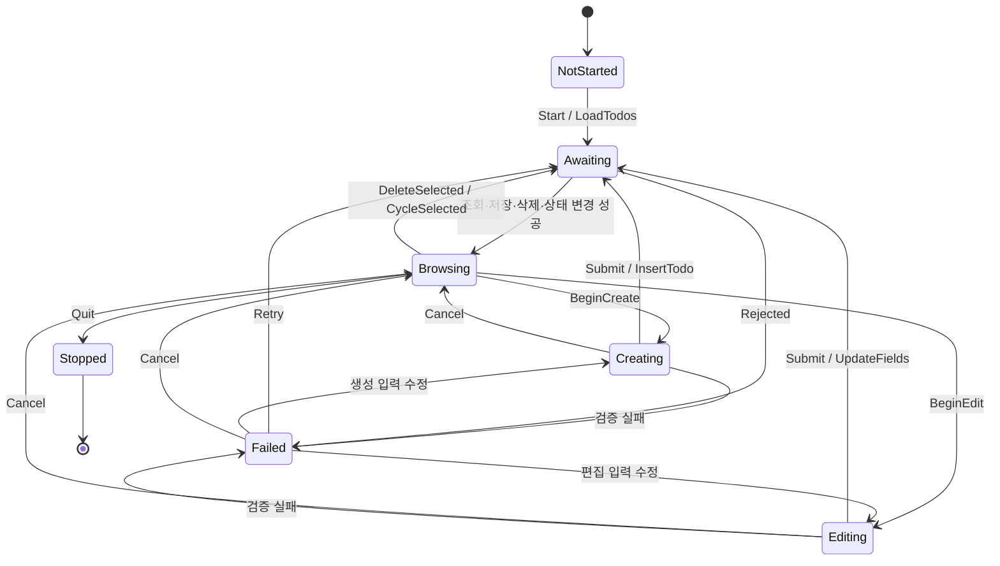

# ADT 상태 머신 아키텍처

Todo의 업무 흐름은 순수 함수 `transition :: Event -> Workflow -> (Workflow, [Command])`가 결정한다. Brick은 키 입력을 이벤트로 변환하고, 저장소는 명령을 실행해 결과 이벤트를 돌려준다.

## 워크스페이스

| 위치 | 패키지 | 책임 | 의존성 |
| --- | --- | --- | --- |
| `packages/domain/` | `tto-domain` | Todo 모델, 필드 검증, 상태 전이 | `base` |
| `packages/application/` | `tto-application` | 상태 머신, 이벤트, 명령, 저장소 포트 | `base`, `tto-domain` |
| `packages/terminal/src/` | `tto`의 라이브러리 | Brick, SQLite, YAML, 파일 로딩 | domain, application, 외부 라이브러리 |
| `apps/tto/` | `tto-exe` | 설정 로딩, DB 연결 수명 관리, 의존성 조립 | terminal |

루트 `package.yaml`은 terminal 라이브러리와 실행 파일 및 어댑터 테스트를 정의한다. `stack.yaml`이 세 패키지를 워크스페이스로 묶는다. 다른 패키지 코드는 Cabal 패키지 의존성과 Haskell 모듈 import로 참조한다.

## 도메인

`Todo.Domain.Model`의 `Todo`는 문자열 대신 `TodoStatusType`을 상태로 사용한다. 필드 값은 `validateFields`로 생성한다. 생성자와 레코드 갱신용 필드는 외부에 노출하지 않는다. 필수 action이 비어 있으면 `EmptyAction`을 반환하고, 연속 공백은 하나로 정리하며, 빈 선택 필드는 `Nothing`으로 바꾼다. 생성과 편집에 동일한 검증을 적용한다.

기존 `TodoStatus`의 GADT 전이 API는 유지한다. 동적인 작업 흐름에서는 닫힌 ADT인 `TodoStatusType`과 `nextStatus`를 사용한다.

```text
Registered → InProgress → Cancelled → Completed → Registered
```

SQLite에 저장하는 문자열 변환은 저장소 경계에서만 수행한다. 알 수 없는 저장 상태는 `InvalidStoredStatus`로 보고한다. UI 문자열은 도메인 상태를 표시하기 위한 투영이다.

## 작업 상태



`Quit`는 종료 상태를 제외한 모든 상태에서 사용할 수 있다. `Stopped`에서는 뒤늦게 도착한 결과를 포함한 모든 이벤트를 무시한다.

`Editing Todo Form`은 편집 대상과 입력을 함께 보유한다. 목록 인덱스를 별도로 저장하지 않는다. 선택 항목도 ID로 추적한다. `Awaiting Pending`에는 실행 중인 작업과 복구에 필요한 입력이 포함된다. 저장 대기 중 중복 입력이나 작업 종류·대상·예상 상태가 맞지 않는 결과는 적용하지 않는다.

`Failed WorkflowError Recovery`는 실패 원인과 복구 정보를 가진다. 실패한 생성·편집은 입력을 보존한다. 삭제·상태 변경의 재시도는 원래 ID와 예상 상태를 사용한다. 잘못된 필수 입력에서는 저장소 명령을 생성하지 않는다.

## 명령과 저장소 포트

`Todo.Application.Repository.Repository m`은 조회·생성·편집·삭제·상태 변경을 추상화한다. 모든 반환값은 도메인 값 또는 `WorkflowError`이며 SQLite나 Brick 타입을 포함하지 않는다.

`runCommand`는 명령을 해당 포트에 전달하고 `Succeeded Result` 또는 `Rejected WorkflowError` 이벤트로 변환한다. 실제 부수 효과는 `Infrastructure.Repository.sqliteRepository`가 수행한다.

쓰기와 확인 조회는 하나의 SQLite 트랜잭션이다. 확인 조회에서 잘못된 데이터나 오류가 발견되어도 쓰기를 롤백한다. 없는 행, 오래된 상태를 기준으로 한 변경, 잘못된 저장 값은 명시적으로 실패한다. 영향받은 행 수를 확인하며, 삭제는 실제 행이 사라졌는지도 확인한다. SQLite가 적용하지 않은 쓰기는 `WriteNotApplied`로 보고한다. 동기 예외는 오류 이벤트로 변환하고 비동기 예외는 다시 전달한다.

## 터미널 어댑터

- `UI.Events`: 현재 상태에 맞는 단축키 해석, 업무 이벤트 전달, 명령 실행 및 결과 전달.
- `UI.Types`: 순수 워크플로 상태를 목록·입력기·커서 위치로 투영. DB 연결을 보유하지 않는다.
- `UI.Draw`, `UI.Attributes`: 표시와 스타일.
- `Config`, `I18n`: 부수 효과 없는 설정·메시지 값 및 변환.
- `Infrastructure.Configuration`, `Infrastructure.Messages`: 파일 접근, YAML 읽기, 로딩 안내.
- `DB`: 기존 스키마와 SQLite 연산.

입력 중에는 저장·취소 키만 명령으로 해석한다. 따라서 `q` 같은 목록 단축키도 텍스트로 입력할 수 있으며, 기본 설정에서 종료와 취소에 겹치는 `Esc`도 입력 모드에서는 취소로 동작한다. Tab은 네 필드를 순환한다.

## 검증

```bash
stack test --fast
find apps packages test Setup.hs -type d -name .stack-work -prune -o -type f -name '*.hs' -exec fourmolu --mode check {} +
hlint apps packages test Setup.hs
python3 scripts/test_release.py -v
```

도메인·상태 전이는 IO 없이 검증한다. 어댑터는 메모리 SQLite로 실제 저장 결과, 실패 및 롤백을 검증한다. 기존 DB·다국어·키 설정·화면 유틸리티 테스트도 유지한다.
